# UpLOAD ER Diagram

Generated from the SQLAlchemy models (`backend/app/**/models.py`), which migration `0006` brings `upload_db` in line with.
Regenerate after schema changes (see [MIGRATIONS.md](MIGRATIONS.md)). Notation: `||` exactly one, `|o` zero or one, `o{` zero or many, `o|` zero or one on the child side (one-to-one). PK primary key, FK foreign key, UK unique.

## Overview (all 43 tables)

```mermaid
erDiagram
    college_slots |o--o{ orders : "slot_id"
    college_slots ||--o{ delivery_batches : "slot_id"
    colleges ||--o{ college_slots : "college_id"
    colleges ||--o{ delivery_batches : "college_id"
    colleges ||--o{ orders : "college_id"
    colleges ||--o{ rider_colleges : "college_id"
    colleges ||--o{ shop_colleges : "college_id"
    colleges ||--o{ student_profiles : "college_id"
    complaints |o--o{ refunds : "complaint_id"
    complaints ||--o{ complaint_attachments : "complaint_id"
    delivery_batches |o--o{ custody_events : "batch_id"
    delivery_batches |o--o{ ledger_entries : "batch_id"
    delivery_batches ||--o{ batch_declines : "batch_id"
    delivery_batches ||--o{ batch_orders : "batch_id"
    delivery_batches ||--o{ batch_shop_arrivals : "batch_id"
    delivery_batches ||--o{ shelf_photos : "batch_id"
    order_documents ||--o{ print_rules : "document_id"
    orders |o--o{ ledger_entries : "order_id"
    orders |o--o{ notifications : "order_id"
    orders ||--o{ batch_orders : "order_id"
    orders ||--o{ complaints : "order_id"
    orders ||--o{ complaints : "order_id, student_id"
    orders ||--o{ custody_events : "order_id"
    orders ||--o{ order_documents : "order_id"
    orders ||--o{ order_events : "order_id"
    orders ||--o{ order_rejections : "order_id"
    orders ||--o{ payments : "order_id"
    orders ||--o{ refunds : "order_id"
    orders ||--o| handover_otps : "order_id"
    orders ||--o| order_quotations : "order_id"
    payments ||--o{ refunds : "payment_id"
    payments ||--o{ refunds : "payment_id, order_id"
    rider_profiles |o--o{ delivery_batches : "rider_id"
    rider_profiles ||--o{ batch_declines : "rider_id"
    rider_profiles ||--o{ rider_colleges : "rider_id"
    rider_profiles ||--o{ rider_settlements : "rider_id"
    rider_settlements |o--o{ delivery_batches : "settlement_id"
    roles ||--o{ users : "role"
    services ||--o{ shop_services : "service_code"
    settlements |o--o{ orders : "settlement_id"
    settlements |o--o{ refunds : "shop_settlement_id"
    shop_profiles |o--o{ delivery_batches : "shop_id"
    shop_profiles |o--o{ orders : "chosen_shop_id"
    shop_profiles |o--o{ orders : "shop_id"
    shop_profiles ||--o{ batch_orders : "shop_id"
    shop_profiles ||--o{ batch_shop_arrivals : "shop_id"
    shop_profiles ||--o{ order_rejections : "shop_id"
    shop_profiles ||--o{ settlements : "shop_id"
    shop_profiles ||--o{ shop_binding_prices : "shop_id"
    shop_profiles ||--o{ shop_colleges : "shop_id"
    shop_profiles ||--o{ shop_rate_cards : "shop_id"
    shop_profiles ||--o{ shop_services : "shop_id"
    users |o--o{ audit_logs : "actor_id"
    users |o--o{ complaints : "resolved_by"
    users |o--o{ custody_events : "actor_id"
    users |o--o{ order_events : "actor_id"
    users |o--o{ refunds : "decided_by"
    users ||--o{ complaint_attachments : "uploaded_by"
    users ||--o{ complaints : "student_id"
    users ||--o{ notifications : "user_id"
    users ||--o{ orders : "student_id"
    users ||--o{ refresh_tokens : "user_id"
    users ||--o{ shelf_photos : "uploaded_by"
    users ||--o| admin_profiles : "user_id"
    users ||--o| rider_profiles : "user_id"
    users ||--o| shop_profiles : "user_id"
    users ||--o| student_profiles : "user_id"
```

## 1. Users & authentication

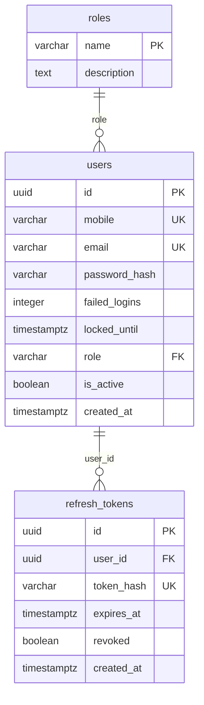

Links to other modules: `audit_logs.actor_id` → `users`; `complaints.resolved_by` → `users`; `custody_events.actor_id` → `users`; `order_events.actor_id` → `users`; `refunds.decided_by` → `users`; `complaint_attachments.uploaded_by` → `users`; `complaints.student_id` → `users`; `notifications.user_id` → `users`; `orders.student_id` → `users`; `shelf_photos.uploaded_by` → `users`; `admin_profiles.user_id` → `users`; `rider_profiles.user_id` → `users`; `shop_profiles.user_id` → `users`; `student_profiles.user_id` → `users`

## 2. Profiles

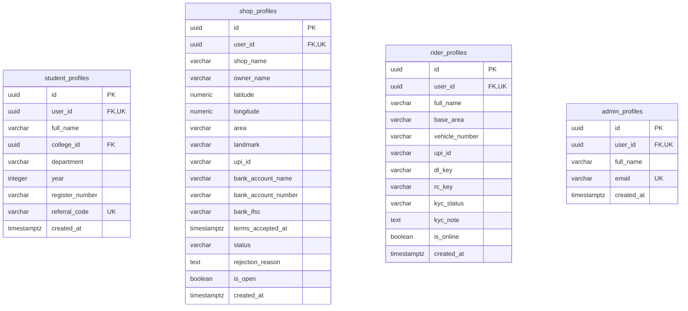

Links to other modules: `student_profiles.college_id` → `colleges`; `delivery_batches.rider_id` → `rider_profiles`; `batch_declines.rider_id` → `rider_profiles`; `rider_colleges.rider_id` → `rider_profiles`; `rider_settlements.rider_id` → `rider_profiles`; `delivery_batches.shop_id` → `shop_profiles`; `orders.chosen_shop_id` → `shop_profiles`; `orders.shop_id` → `shop_profiles`; `batch_orders.shop_id` → `shop_profiles`; `batch_shop_arrivals.shop_id` → `shop_profiles`; `order_rejections.shop_id` → `shop_profiles`; `settlements.shop_id` → `shop_profiles`; `shop_binding_prices.shop_id` → `shop_profiles`; `shop_colleges.shop_id` → `shop_profiles`; `shop_rate_cards.shop_id` → `shop_profiles`; `shop_services.shop_id` → `shop_profiles`; `admin_profiles.user_id` → `users`; `rider_profiles.user_id` → `users`; `shop_profiles.user_id` → `users`; `student_profiles.user_id` → `users`

## 3. Colleges & delivery slots

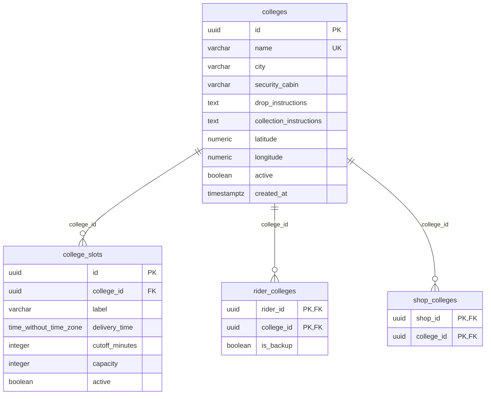

Links to other modules: `orders.slot_id` → `college_slots`; `delivery_batches.slot_id` → `college_slots`; `delivery_batches.college_id` → `colleges`; `orders.college_id` → `colleges`; `student_profiles.college_id` → `colleges`; `rider_colleges.rider_id` → `rider_profiles`; `shop_colleges.shop_id` → `shop_profiles`

## 4. Shops, services & rate cards

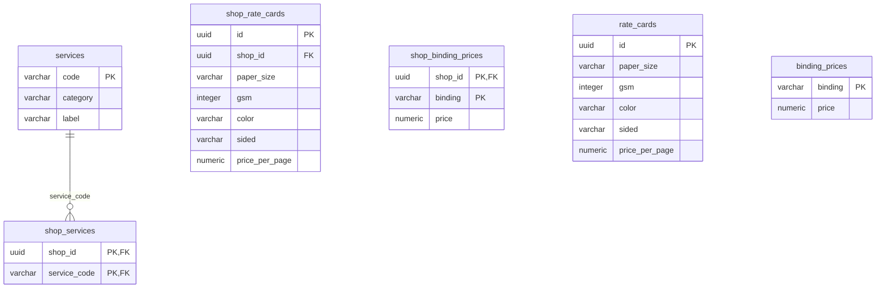

Links to other modules: `shop_binding_prices.shop_id` → `shop_profiles`; `shop_rate_cards.shop_id` → `shop_profiles`; `shop_services.shop_id` → `shop_profiles`

## 5. Documents, orders & print customisation

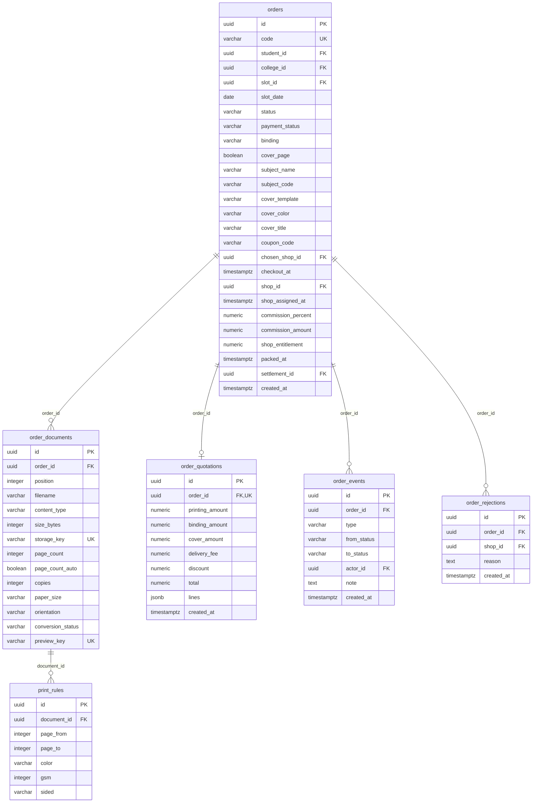

Links to other modules: `orders.slot_id` → `college_slots`; `orders.college_id` → `colleges`; `ledger_entries.order_id` → `orders`; `notifications.order_id` → `orders`; `batch_orders.order_id` → `orders`; `complaints.order_id` → `orders`; `complaints.order_id, student_id` → `orders`; `custody_events.order_id` → `orders`; `payments.order_id` → `orders`; `refunds.order_id` → `orders`; `handover_otps.order_id` → `orders`; `orders.settlement_id` → `settlements`; `orders.chosen_shop_id` → `shop_profiles`; `orders.shop_id` → `shop_profiles`; `order_rejections.shop_id` → `shop_profiles`; `order_events.actor_id` → `users`; `orders.student_id` → `users`

## 6. Payments, coupons & refunds

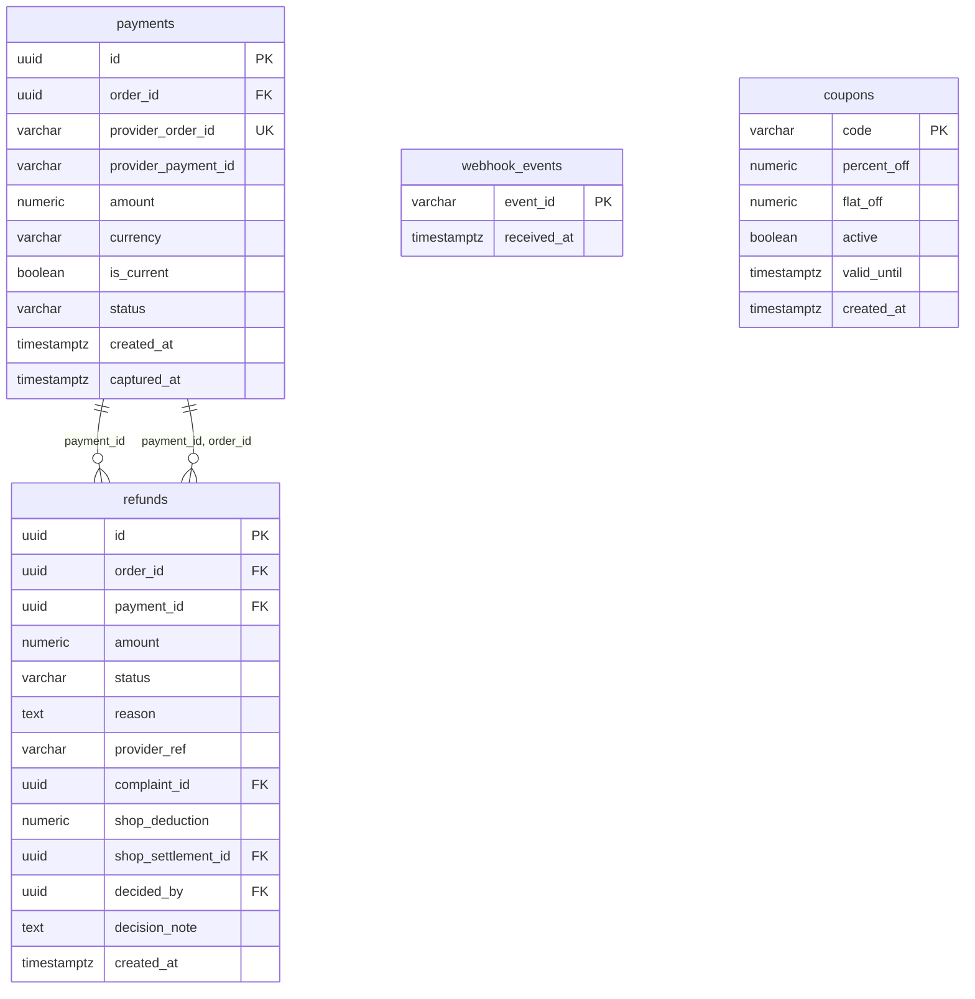

Links to other modules: `refunds.complaint_id` → `complaints`; `payments.order_id` → `orders`; `refunds.order_id` → `orders`; `refunds.shop_settlement_id` → `settlements`; `refunds.decided_by` → `users`

## 7. Delivery batches, pickup OTPs & custody

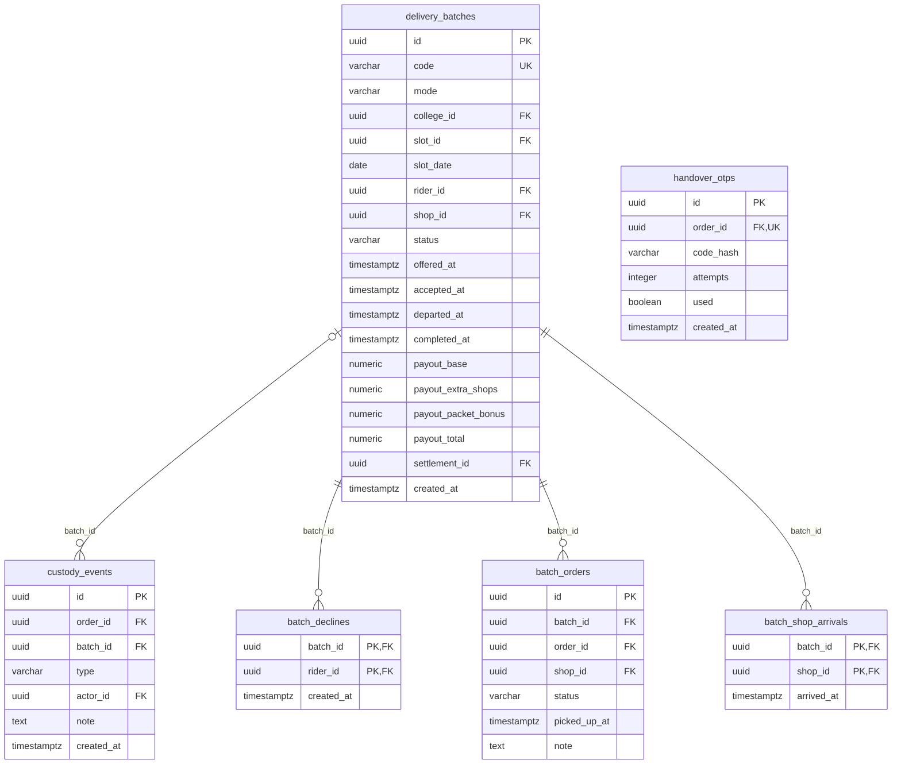

Links to other modules: `delivery_batches.slot_id` → `college_slots`; `delivery_batches.college_id` → `colleges`; `ledger_entries.batch_id` → `delivery_batches`; `shelf_photos.batch_id` → `delivery_batches`; `batch_orders.order_id` → `orders`; `custody_events.order_id` → `orders`; `handover_otps.order_id` → `orders`; `delivery_batches.rider_id` → `rider_profiles`; `batch_declines.rider_id` → `rider_profiles`; `delivery_batches.settlement_id` → `rider_settlements`; `delivery_batches.shop_id` → `shop_profiles`; `batch_orders.shop_id` → `shop_profiles`; `batch_shop_arrivals.shop_id` → `shop_profiles`; `custody_events.actor_id` → `users`

## 8. Shelf photo proofs & collection

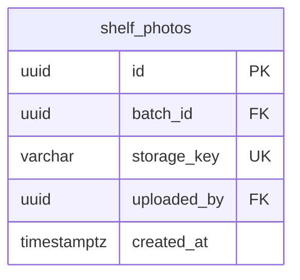

Links to other modules: `shelf_photos.batch_id` → `delivery_batches`; `shelf_photos.uploaded_by` → `users`

## 9. Complaints & resolutions

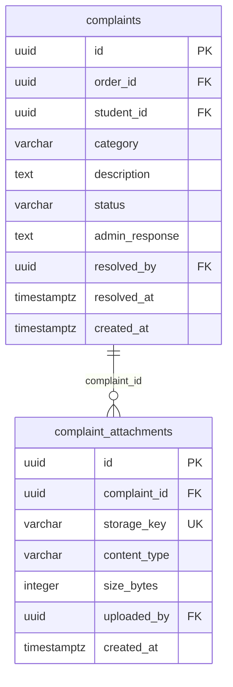

Links to other modules: `refunds.complaint_id` → `complaints`; `complaints.order_id` → `orders`; `complaints.order_id, student_id` → `orders`; `complaints.resolved_by` → `users`; `complaint_attachments.uploaded_by` → `users`; `complaints.student_id` → `users`

## 10. Ledger & settlements

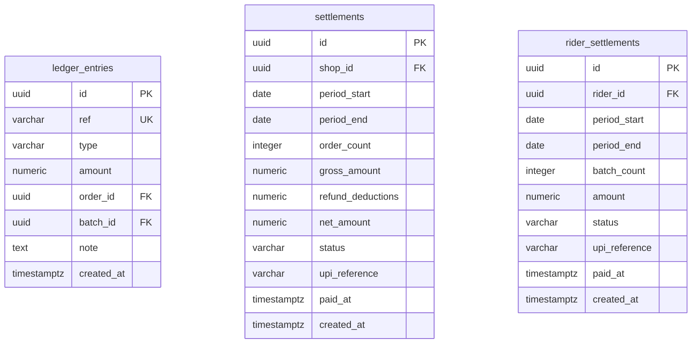

Links to other modules: `ledger_entries.batch_id` → `delivery_batches`; `ledger_entries.order_id` → `orders`; `rider_settlements.rider_id` → `rider_profiles`; `delivery_batches.settlement_id` → `rider_settlements`; `orders.settlement_id` → `settlements`; `refunds.shop_settlement_id` → `settlements`; `settlements.shop_id` → `shop_profiles`

## 11. Notifications

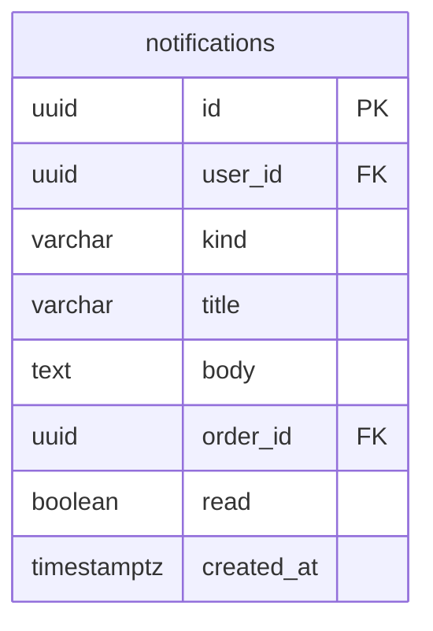

Links to other modules: `notifications.order_id` → `orders`; `notifications.user_id` → `users`

## 12. Admin settings & audit

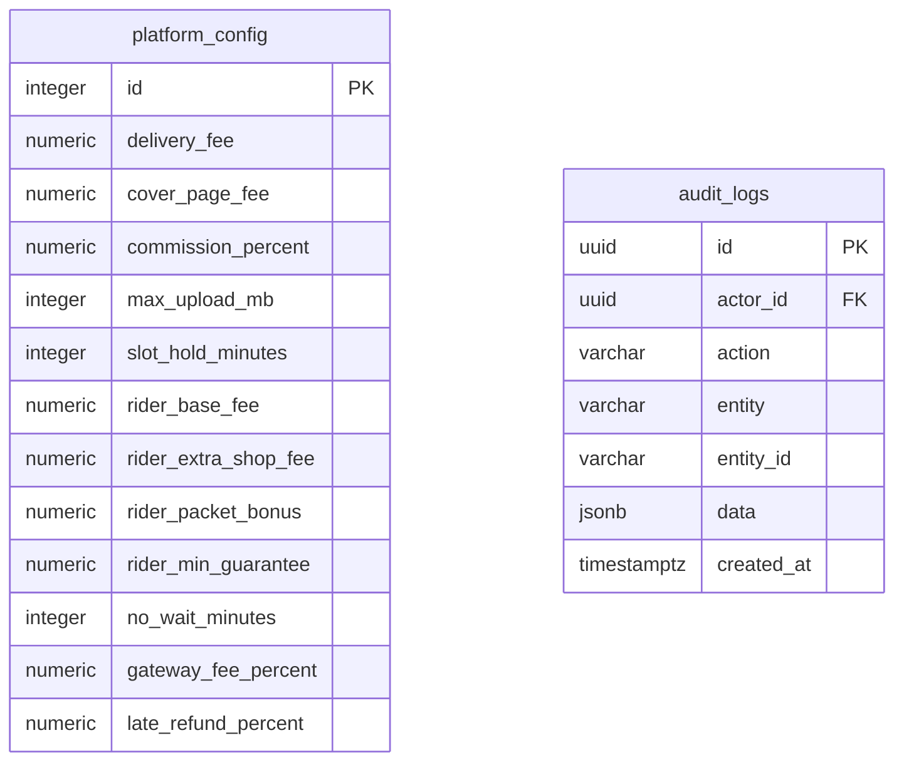

Links to other modules: `audit_logs.actor_id` → `users`
